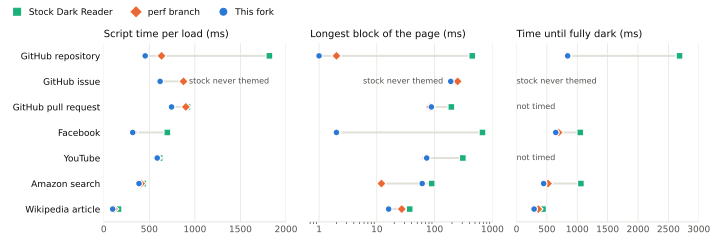
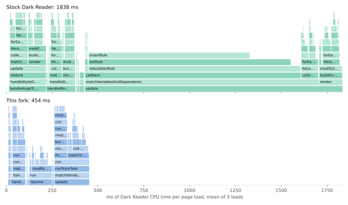

# Dark Reader, fast

> [!WARNING]
> No human has read a line of this code. AI coding agents made every change: Claude Code running Claude Opus 5.5, with Fable (Claude Fable 5.1) and Astra (GPT-6 Astra in OpenAI's Codex). They also wrote the new tests and the benchmark. Beyond those, the only review is my own use. Install it at your own risk.

I used Dark Reader for years, until its slowness made me uninstall it. Pages took seconds to darken, and some tabs sat on a flat grey page until I reloaded them.

LLMs can now take a program like this apart, find where the time goes, and fix it. So I had them do that, and this is the result: my fork, with my defaults. Software you once had to put up with, you can now just change.

It isn't a product. Nobody here will answer issues or review pull requests. If you want something different, fork it and have your own agents change it. The commits that only make it faster are on the `perf` branch, on top of upstream, in case Dark Reader's maintainers want them.

## Speed

<picture>
  <source media="(prefers-color-scheme: dark)" srcset="docs/benchmark/speed-dark.svg">
  
</picture>

Each mark is the median of three page loads. Script time is how long Dark Reader's own code ran. Longest block is the most Dark Reader time inside one long task, while the page could not respond to input. Time until fully dark is when the full theme replaced Dark Reader's plain loading cover. On the GitHub issue page, stock never got past that cover.

<picture>
  <source media="(prefers-color-scheme: dark)" srcset="docs/benchmark/flame-github-repo-dark.svg">
  
</picture>

Both flame graphs share one time scale. On a GitHub repository page, most of stock's time goes down one path: every CSS variable update rebuilt and re-inserted the whole rule that held it.

### Where the time went

1. Updating a CSS variable rewrote and reparsed the whole rule that held it. Only the changed declarations are updated now (0c12aa6e).
2. Colour parsing and image analysis drew on a DOM canvas, whose first draw cost 130–150 ms on any page with `oklch()`, `lab()` or `color-mix()` colours. An `OffscreenCanvas` takes under 1 ms (edd795a4).
3. Each SVG with a `fill` attribute was measured and then styled in turn, so every measurement forced a fresh layout. The measurements are now taken in one batch before any style is written (43bafa63).
4. The check for a site's own dark theme forces full style and layout passes, up to a second on a large shopping page, and it ran again on every theme message. It now runs once per page, and on GitHub it reads the theme attributes instead (0b4f5c45, 1b9b75f2).
5. A background tab was not themed until it was shown, so switching to a heavy tab ran the whole pass as one long task, about 2.4 s on a heavy social page. Tabs are now themed while they load, and only later re-theming waits until they are shown (aef521ed, cfcdf684).
6. Long stylesheet and variable scans now yield to the page between chunks (e9eeb74c).
7. Every frame load or unload in any tab rewrote the state of all open tabs to storage, and the write came back as a change event that read it all again. With 200 open tabs, one page load wrote 0.75 MB and cost the service worker 36–41 ms. Each tab now has its own key in session storage, so a page load writes 0.01 MB and costs 3–7 ms. Alt+D reaches the active tab before background tabs, which halves its delay when many tabs share a site (446db9be).
8. The image cache list in session storage gained a duplicate entry for every image analysed (e519a870).
9. Dark Reader's own inserted styles counted as moved page styles, so the first batch of page changes re-rendered every managed stylesheet: all 26 on a GitHub repository page. Its own styles are now ignored in that check (75dd535b).

Items 1 to 8 are on `perf`. Item 9 is on `main` only, with two fixes to CSS variable typing (566fc168, 8c4a61be), because those also change the output: they restore backgrounds that stock drops on GitHub and YouTube.

On Amazon the longest block is longer on `main` than on `perf`, though still shorter than stock. The dark-theme check now waits until the page has loaded, which puts it inside one of the page's own long tasks. Waiting is what lets it see dark themes that load late.

## What else is different

1. No calls to darkreader.org: no news poll, install or uninstall pages, donation banners, or download of remote site fixes. Site fixes come from the source tree and update when upstream is merged.
2. Alt+D switches Dark Reader for the current site, PDFs included, and remembers the choice. Alt+Shift+D switches the extension off and on everywhere.
3. The theme uses a grey background, #1f1f1f, with #f0f0f0 text, contrast +10 and brightness +5, instead of near-black.
4. The toolbar icon is faded on tabs Dark Reader is not darkening.
5. Sites with their own dark theme are recognised more reliably and left alone. The check waits until the page has loaded and its tab is shown, pauses the page's transitions while it samples colours, and no longer takes a bright button for a light background. In a sample of 202 recently shared pages, 11 already-dark pages that stock darkens again are now left alone, and no light page lost its theme.
6. Pale tints such as cream backgrounds stay near-neutral instead of turning brown.
7. Settings sync through the browser by default.

## Bugs fixed that stock still has

1. Any element with a `bgcolor` attribute threw an error and stayed light, a regression from upstream 404e8cfe. Style sheets also win over the attribute again, as they do in browsers.
2. A page whose first message to the extension was lost, for example while the service worker restarted, stayed on the plain grey cover until refreshed.
3. Every GitHub page logged an uncaught error from the extension, because GitHub's inline logo SVG has no `xmlns` and cannot load as an image.
4. After the extension reloaded, scripts left in open tabs threw "Extension context invalidated".
5. PDFs in Chromium's current viewer could stay white.
6. Every extension page logged "Unrecognized Content-Security-Policy directive 'navigate-to'".

## Install

There is no store listing. Build the extension and load it unpacked:

```
npm install
npm run build -- --chrome-mv3
```

Then in Brave or Chrome:

1. Open `brave://extensions` (`chrome://extensions` in Chrome) and turn on Developer mode.
2. Click Load unpacked and choose `build/release/chrome-mv3`.
3. Remove stock Dark Reader. In Brave, also set `brave://flags/#enable-force-dark` to Disabled, or pages are darkened twice.
4. Check the keys at `brave://extensions/shortcuts`.

To update, pull, rebuild, and click the reload arrow on the extension's card.

The browser derives an unpacked extension's ID from its folder path, and synced settings are stored under that ID. Load the build from the same path on every machine whose settings should sync.

## Benchmark

1. `src/one_offs/benchmark-load.mjs` starts a fresh headless browser profile, loads each URL once with the given build, and appends one JSON row per page to `build/bench/LABEL.jsonl`. Branded Chrome ignores `--load-extension`, so point `CHROME_BIN` at [Chrome for Testing](https://googlechromelabs.github.io/chrome-for-testing/).
2. `docs/benchmark/results.csv` holds every run behind the speed chart, and `src/one_offs/plot-benchmark.py` draws it.
3. `src/one_offs/flame-compare.py` folds the CPU profiles into `docs/benchmark/*.folded` and draws the flame graphs.

```
CHROME_BIN=/path/to/chrome-for-testing node src/one_offs/benchmark-load.mjs build/release/chrome-mv3 main-r1 9410 https://github.com/microsoft/vscode
```

The charts come from Chrome for Testing 146, headless, with a fresh profile per build, a light system scheme and no logins, on 10 October 2026. The three builds ran in turn, three rounds each. Stock is upstream 93b124d9.

Tests: `npm test` runs the unit tests, and `CHROME_BIN=... node src/one_offs/test-inject-cft.mjs` runs the browser tests in a browser it owns.

## Credit

Dark Reader is by Alexander Shutau and its contributors, under the MIT licence, which this fork keeps. Nearly all of the code is theirs.
